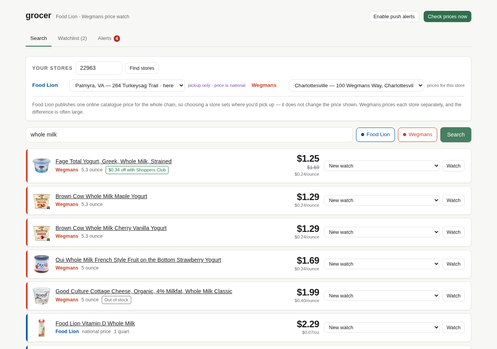
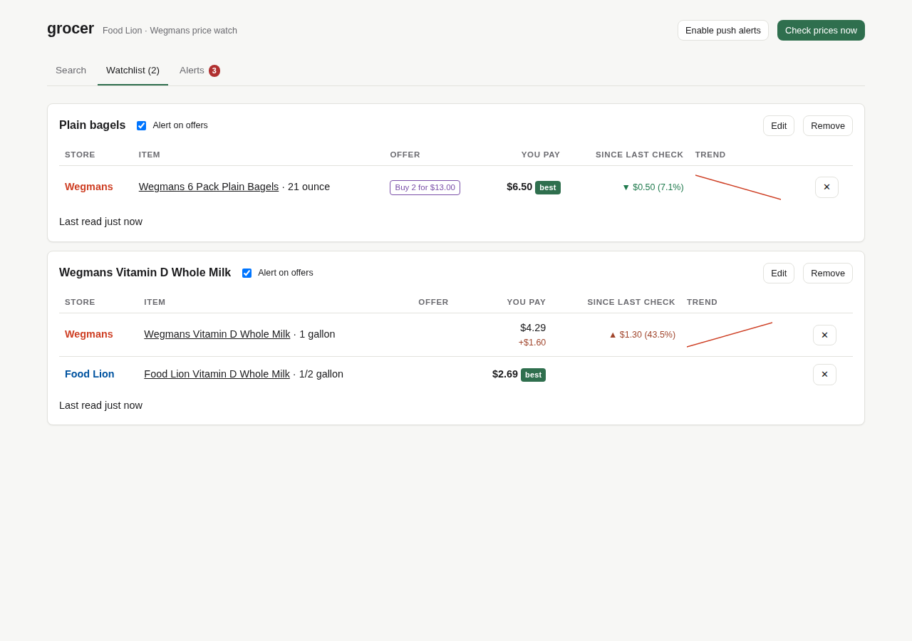
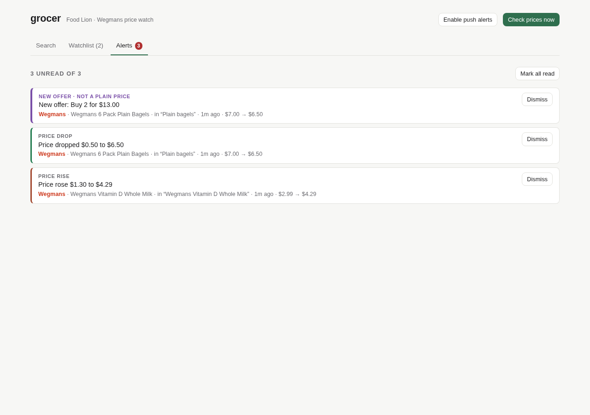

# bastille

Search Food Lion, Wegmans and Trader Joe's together, watch items across all three, and get told
when a price moves — whether the move is a number or a "Buy 2 for $13.00".

It also sweeps the in-store clearance racks at as many nearby Walmarts as you
care to name, and tells you the aisle.

| search | watchlist | alerts |
|---|---|---|
|  |  |  |

## Why the effective unit price

A grocery offer is not always a number. `$3.49` compares by subtraction;
`BOGO`, `2 for $5`, `Buy 1 Get 1 50% Off`, and `$1.00 off with Shoppers Club`
do not. bastille parses each offer into a structured promotion and, where the
arithmetic is unambiguous, reduces it to an **effective unit price** — what you
pay per item once the deal is applied. That is the figure the UI ranks on, so a
BOGO on a $4.99 item sorts against a plain $2.49 correctly.

When an offer cannot honestly be reduced to a number, bastille says so: the row
shows the store's own words instead of a price and drops out of numeric
ranking. It never invents a figure.

Price changes and promotion changes are tracked separately, because they move
independently:

| change | numeric? | example |
|---|---|---|
| `price_drop` / `price_rise` | yes | $2.99 → $2.49 |
| `promo_started` | no | BOGO appears on an unchanged $4.99 |
| `promo_ended` / `promo_changed` | no | "2 for $13" replaced by "$1 off" |
| `back_in_stock` / `out_of_stock` | no | |

A promotion starting on an item whose shelf price did not move still alerts.

## Walmart in-store clearance

Walmart marks stock down in store, and publishes which aisle it is in. That is
worth knowing before a drive, and it is not on the shelf-price side of the app
at all — so Walmart is not a third price-comparison chain here. It is a nightly
read of one store's clearance racks.

**One store, and you do not choose it.** Walmart resolves the store from the
requesting address: the identical request answers for Gordonsville from a
Virginia line and for Sacramento through an Amsterdam exit, whatever store the
cookie names. So bastille asks Walmart which store it serves this connection,
records that, and reads its racks. A sweep refuses to record anything if a later
response names a different store — which is what would catch the address moving
under it.

Each night it records every item on clearance across three shelves:

| | |
|---|---|
| what | price now, the pre-markdown price where Walmart still shows one, percent off |
| where | the shelf code — `K14`, `L13`, `H31` |
| new? | anything that was not on that store's rack yesterday is flagged |

Saved terms (`rtx`, `nvme`, `ryzen`) are matched against each night's new finds
and raise an alert, so a graphics card appearing on a rack 8 miles away does not
depend on you opening the app.

Walmart's edge starts refusing after roughly twenty reads however far apart they
are spaced — the limit is on the count, not the cadence. Three shelves is well
inside that, but the sweep still waits 20-32 seconds between reads, stands down
for five minutes on a refusal, and gives up after four in a row.
`POST /api/clearance/sweep` starts it and returns rather than holding the
connection open; the Clearance tab polls for progress.

Items are split into **PC parts & computers** and **other electronics** by which
of Walmart's own shelves they appear on, not by a keyword match on the title.
Walmart reports a different category path for the same item depending on which
shelf you ask, so the path is not a reliable answer to "what is this"; shelf
membership is.

A clearance sticker often carries no "was" price. bastille records the price and
leaves the discount blank rather than inventing a baseline, the same rule the
grocery side follows for offers that are not numbers.

Walmart returns a second list alongside each shelf, titled "Available for
shipping" — national stock it will post to you, with no aisle and the same price
everywhere. That list is discarded. What is recorded is what is on that store's
rack.

`docs/WALMART-CLEARANCE-API.md` has the full write-up: what is reachable, what
is not, and why the sweep is deliberately slow.

## Running it

```bash
npm install
npm run build
npm start          # http://127.0.0.1:5175
```

For development, run the API and the Vite dev server side by side:

```bash
npm run dev        # api on :5175, dashboard on :5174 (proxied)
```

### Running it for real

The poller, the daily snapshot and the Walmart clearance sweep are all
scheduled **inside the server process**. Nothing is a cron job, so if the
process is not running, none of them run. Install the unit:

```bash
cp .env.example .env    # then edit
ln -s "$PWD/deploy/systemd/bastille.service" ~/.config/systemd/user/
systemctl --user daemon-reload
systemctl --user enable --now bastille.service
```

`loginctl enable-linger $USER` if you want it up without a login session.

Tests:

```bash
npm test                       # unit + live end-to-end
BASTILLE_SKIP_LIVE=1 npm test    # unit only, no network
```

The live suite drives the HTTP API against the real storefronts, so it needs
network access and is sensitive to the stores actually stocking the products it
looks up.

## Configuration

| variable | default | meaning |
|---|---|---|
| `PORT` / `HOST` | `5175` / `127.0.0.1` | API and dashboard bind |
| `BASTILLE_DB` | `data/bastille.db` | SQLite file (the deployed unit points this at `/scratch/bastille/bastille.db`, off the root filesystem) |
| `BASTILLE_POLL_INTERVAL_MS` | `1800000` | how often watched prices are re-read |
| `BASTILLE_MIN_REQUEST_INTERVAL_MS` | `700` | floor between requests to one host |
| `WEGMANS_STORE` | `24` | default Wegmans store number |
| `FOODLION_AISLE_TTL_MS` | `1800000` | Food Lion single-aisle cache lifetime |
| `FOODLION_CATALOGUE_TTL_MS` | `21600000` | Food Lion full aisle-tree crawl lifetime |
| `BASTILLE_SNAPSHOT_RETENTION_DAYS` | `90` | snapshot days kept on disk; `0` keeps every day |
| `FOODLION_STORES_TTL_MS` | `86400000` | Food Lion store directory cache lifetime |
| `WEGMANS_STORES_TTL_MS` | `86400000` | Wegmans store list cache lifetime |
| `BASTILLE_SNAPSHOT_HOUR` | `3` | local hour (0-23) the daily snapshot runs |
| `WEGMANS_SNAPSHOT_PRODUCTS` | `50000` | Wegmans products captured per daily snapshot (the catalogue is ~44,000 per store, so the default captures all of it; a lower budget is spread across departments in proportion to their size) |
| `SNAPSHOT_WEGMANS_STORE` | `WEGMANS_STORE` | Wegmans store the snapshot is taken at |
| `BASTILLE_SEARCH_TTL_MS` | `60000` | server-side per-store search cache lifetime |
| `BASTILLE_SWEEP_HOUR` | `4` | local hour (0-23) the Walmart clearance sweep runs |
| `WALMART_REQUEST_INTERVAL_MS` | `20000` | floor between Walmart reads — its edge rate-limits hard |
| `WALMART_REQUEST_JITTER_MS` | `12000` | extra random spread on top of that floor |
| `WALMART_RATE_LIMIT_COOLDOWN_MS` | `300000` | how long the sweep stands down after a refusal |
| `WALMART_MAX_CONSECUTIVE_RATE_LIMITS` | `4` | consecutive refusals after which the run gives up |
| `WALMART_SWEEP_READ_BUDGET` | `12` | reads one sweep may spend, refusals included; shelves are spent Computers → Electronics → Video games |
| `WALMART_SWEEP_SORT` | `new` | shelf ordering; `new` pages without the overlap `best_match` re-ranking causes |
| `WALMART_SWEEP_DELTA` | off | `1` stops each shelf at the first page with nothing new and carries the rest forward |
| `WALMART_FULL_SWEEP_DAYS` | `7` | in delta mode, days between forced full passes |
| `WALMART_BUDGET_WINDOW_MS` | `1800000` | window the persisted read count is kept over |
| `WALMART_WINDOW_READ_LIMIT` | `18` | reads allowed per window, shared by the sweep, manual sweeps and restarts |
| `WALMART_STORE_FINDER_HASH` | *(pinned)* | persisted-query hash, if Walmart rotates it |
| `WALMART_BROWSE_HASH` | *(pinned)* | persisted-query hash, if Walmart rotates it |

## Picking your stores

Enter a ZIP once and every chain resolves to real nearby stores, nearest first
with distances. The selected store and price scope remain explicit in every
result.

The two chains mean different things by "your store", and the app says which is
which rather than blurring them:

- **Wegmans prices per store**, and the spread is large — the same gallon of
  milk ran $2.49 to $5.09 across stores on one day. Changing the store changes
  the price, and the watchlist records prices per store.
- **Food Lion publishes one online catalogue price chain-wide.** Its store
  choice sets where you'd pick up; it does not change the price. Food Lion rows
  are labelled `national price`, and every reading is recorded under a single
  price scope so switching stores never forks the history or shows up as a
  price change. `docs/BACKEND-MAP.md` has the tests behind that claim and why
  no per-store Food Lion price is reachable.

ZIP resolution uses the chains' own store coordinates, not a third-party
geocoder. An exact ZIP match is used as-is; otherwise the centroid of stores
sharing the three-digit prefix is used and reported as approximate; a ZIP that
matches nothing leaves the stores unranked rather than showing made-up
distances.

## How it gets the data

Mapped with [Astrolabe](https://github.com/revoydotdev/astrolabe). The full write-up, including
what each store exposes and what it does not, is in
[docs/BACKEND-MAP.md](docs/BACKEND-MAP.md). In short:

- **Wegmans** — first-party REST at `www.wegmans.com/api/*` for stores,
  categories and per-store product detail; search runs against the storefront's
  own Algolia index using the public search-only key it ships to every browser.
- **Food Lion** — the server-rendered catalogue at `foodlion.com/groceries/`,
  which embeds the upstream Peapod product objects (price, regular price, sale
  and BOGO flags, buy-more-save-more tiers, coupons) directly in the page.
  Search is served from a local index built from the same category pages,
  because that surface publishes no search endpoint. Stores come from the open
  Yext directory at `stores.foodlion.com/index.json` — 1,149 stores with
  coordinates.

Food Lion's transactional SPA sits behind Cloudflare and DataDome. bastille does
not touch it.

### Conduct

Read-only throughout. One request at a time per host with a configurable floor
between them, backoff on 429 and 5xx, a browser `User-Agent`, and a 30-minute
cache on the Food Lion catalogue. No accounts, no carts, no checkout, no
challenge solving.

## Layout

```
server/src/
  adapters/      one module per store, all reading, behind a small contract
  geo.ts         distance + ZIP resolution from the chains' own store data
  price/         the promotion model, parser, and change detection
  jobs/poller.ts scheduled re-read of everything watched
  jobs/clearance-sweep.ts  nightly per-store Walmart clearance sweep
  clearance/     Walmart's GraphQL tier, its own store/find/watch tables and routes
  repo.ts        products, price history, watchlists, alerts
  routes.ts      HTTP API + SSE alert stream
web/src/         React dashboard: search (plus paste-a-recipe), deals, clearance, watchlist, alerts (price moves and clearance watch-term matches)
docs/            backend map
DESIGN.md        colour, type, spacing, and what each colour is allowed to mean
```

## API

| method | path | |
|---|---|---|
| GET | `/api/search?q=&stores=&<store>Location=&minDiscount=&promoKinds=&onSale=` | every selected store, cheapest comparable first, filterable |
| GET | `/api/deals?date=&minDiscount=&promoKinds=&onSale=&stores=&sort=` | everything ≥N% off or of a promo kind (e.g. only BOGO), from the latest daily snapshot (live scan before the first snapshot) |
| GET | `/api/snapshot/status` · POST `/api/snapshot/run` | daily-snapshot state / trigger now |
| GET | `/api/stores?postalCode=` | every chain's nearest stores, with distances and whether the chain prices per store |
| GET/POST | `/api/watchlist` | list / add (add to an existing group to compare) |
| PATCH/DELETE | `/api/watchlist/:id` | rename, set a target price, remove |
| DELETE | `/api/watchlist/item/:itemId` | drop one store from a group |
| GET | `/api/prices/:productId` | price history |
| GET | `/api/alerts?unread=1` | alert feed |
| POST | `/api/alerts/:id/ack`, `/api/alerts/ack-all` | dismiss |
| POST | `/api/refresh` | re-read everything now |
| GET | `/api/alerts/stream` | server-sent events, pushed as polls produce them |
| GET | `/api/status` | last poll result |

Walmart clearance:

| method | path | |
|---|---|---|
| GET | `/api/clearance/deals` | everything meeting the monitor's rule, ranked |
| GET | `/api/clearance?groups=&q=&minDiscount=&maxPrice=&new=&sort=` | the latest sweep, filtered |
| GET | `/api/clearance/store` · POST `/api/clearance/store/resolve` | the store on record / ask Walmart which it serves |
| GET/PUT | `/api/clearance/monitor` | the standing "what counts as a deal" rule |
| GET | `/api/clearance/categories` | shelves swept, and the two item groups |
| GET | `/api/clearance/status` · POST `/api/clearance/sweep` | sweep state / run one now |
| GET/POST | `/api/clearance/watches` · DELETE `/api/clearance/watches/:id` | terms to be alerted on |
| GET | `/api/clearance/alerts?unread=1` | clearance alert feed |
| POST | `/api/clearance/alerts/:id/ack`, `/api/clearance/alerts/ack-all` | dismiss |

## License

MIT. See [LICENSE](LICENSE).
